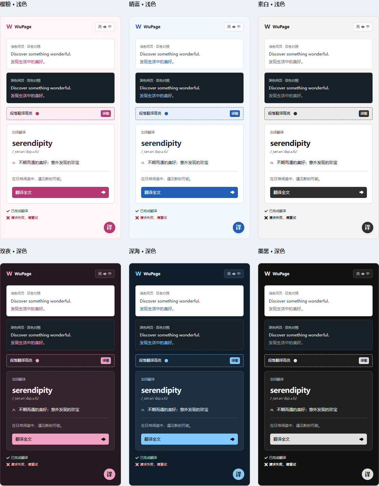

  
  <h1>WuPage Translator</h1>
  
适用于 Microsoft Edge、Chrome 和 Firefox 的网页、视频字幕、图片与 PDF 翻译扩展。

  
支持双语对照、划词查词、暂停画面翻译和 PDF 译文编辑，可选在线服务或本地翻译。

  

    <a href="https://chromewebstore.google.com/detail/wupage-translator/oimcejdmobjcmiklbidamgpfmgkdaiej">Chrome 网上应用店</a> ·
    <a href="https://microsoftedge.microsoft.com/addons/detail/wupage-translator/ophhojnppohaklhcdaheplkodopmplfg">Microsoft Edge 插件商店</a> ·
    <a href="https://addons.mozilla.org/zh-CN/firefox/addon/wupage-translator/">Firefox Add-ons</a> ·
    <a href="https://github.com/mr-wuliu/wupage/releases/latest">下载发布包</a> ·
    <a href="https://wupage.mrwuliu.top/">项目主页</a> ·
    <a href="https://github.com/mr-wuliu/wupage/issues">问题反馈</a> ·
    <a href="PRIVACY.md">隐私政策</a> ·
    <a href="LICENSE">GPL-3.0</a>
  

  

    
  

[功能一览](#功能一览) · [效果预览](#效果预览) · [安装](#安装) · [翻译服务](#翻译服务) · [常见问题](#常见问题) · [反馈与交流](#反馈与交流)

## 功能一览

界面默认跟随浏览器，支持简体中文和英文，其他语言使用英文。可在「设置 → 通用 → 界面语言」切换，点击「保存」后刷新已打开的网页和 PDF。要更改译文的语言，请在弹窗或设置中选择「目标语言」。

| 功能 | 简要说明 |
| --- | --- |
| 网页全文 | 翻译正文、动态加载和嵌入内容，支持恢复原文 |
| 段落翻译 | 桌面端开启后按住 `Ctrl` 点击段落；触屏端使用「点选段落」，完成一次后自动退出；再次翻译同段可恢复原文 |
| 双语显示 | 译文替换、原色对照（默认）、双色对照，可随时切换 |
| 划词翻译 | 选中文字后点击入口查词或翻译；输入框支持翻译所选文字并一键替换；支持有道 / Bing 词典及中文拼音、释义 |
| 单词本 | 在划词查词卡片中收藏词条或译文，从扩展弹窗打开单词本；支持在统一列表中搜索和删除 |
| 自动翻译 | 按网站或页面语言自动翻译，默认关闭 |
| 翻译区域 | 按网站和 CSS 选择器补译漏译区域，或保留指定区域原文；预置可编辑的 X 侧边导航、新闻、趋势、推荐关注和页脚保留原文规则 |
| 视频字幕 | 点击播放器上的「译」翻译已有字幕，支持双语显示与 SRT / VTT 导入；不支持无字幕听译 |
| 暂停画面翻译 | 点击播放器上的屏幕图标，识别并翻译画面文字，需开启视频字幕及图片翻译，并安装内置 OCR 模型或配置自定义 OCR 服务 |
| 图片翻译 | 安装内置 OCR 模型或配置自定义 OCR 服务并开启功能，通过右键菜单或图片旁的「译」原位显示译文；在「设置 → 通用 → 图片翻译」下可分别开关右键菜单和悬浮窗 |
| PDF 阅读 | 打开后自动翻译当前页附近内容，支持原译对照及译文编辑；需有文本层 |
| PDF 导出 | 下载前补全全文翻译；可导出图像版，或安装可选字体后导出可搜索文字 |
| 悬浮球与右键菜单 | 在网页内翻译、恢复原文或切换设置；右键翻译需先开启 |
| 外观与菜单 | 明暗主题、自定义配色与颜色透明度、悬浮球透明度，以及菜单入口的显示和排序 |
| 快捷键 | 默认 `Alt+Shift+Y` 翻译全文；按键和开关可在设置中修改 |
| 使用统计 | 查看用量、成功率、响应时间与接口返回的 Token，默认关闭，仅保存在本机 |

查词卡片中的收藏按钮保存当前词典结果或单词译文。单词本默认按加入时间排序，也可切换字母正序、倒序或乱序；所有排序方式均可按全部日期、月份或具体日期筛选。列表默认只显示单词，点击后展开释义、译文、发音及词典提供的例句。单词本保存在当前浏览器，不会随翻译缓存清理、设置重置或设置备份而清除，也不会同步到其他设备。单词本不保存网页地址。

在 X 的图片右键菜单中，选择「翻译图片」即可翻译当前图片，原有的「复制照片链接」保留。此入口由「图片翻译 → 右键菜单」控制，可在关闭悬浮窗时单独使用。

将鼠标移到悬浮球上展开面板，点击面板内「悬浮球」右侧的下拉箭头，可选择「本页暂时隐藏，刷新后恢复」或在当前网站始终隐藏。触屏上长按悬浮球，再点「更多功能」即可找到该菜单。网站规则按完整域名和端口匹配，子域名可单独设置。要恢复显示，在「设置 → 通用 → 隐藏悬浮球的网站」中移除该网站并点击「保存」。

在「设置 → 快捷键」点击按键框，可录入单键，或给它搭配任意 Ctrl、Alt、Shift、Win / Command 修饰键。绑定 Esc、Tab、Backspace 或 Delete 时，先点「录入特殊键」。点击「保存」后生效。浏览器或系统优先处理的组合可能无法触发扩展。

外观设置中，先复制内置方案即可自定义配色；已有自定义方案可在方案选择器下方直接修改名称。点击颜色右侧的圆形棋盘格按钮可调节该颜色的透明度，100% 为完全不透明，0% 为完全透明，默认均为 100%。颜色透明度与悬浮球整体透明度分别设置，修改后点击「保存」生效。

在「外观 → 配色与外观 → 译文与段落」中关闭「显示段落高亮」，可隐藏段落边框与底色，段落翻译操作保持可用。此开关适用于所有配色方案，修改后点击「保存」生效。

## 效果预览

**译文替换 · 日语 → 简体中文**

| 原文 | 译文 |
| --- | --- |
|  |  |

**PDF 双栏对照 · 英语 → 简体中文**

**外观配色 · 浅色 / 深色**

## 安装

### Google Chrome

从 [Chrome 网上应用店](https://chromewebstore.google.com/detail/wupage-translator/oimcejdmobjcmiklbidamgpfmgkdaiej) 点击「添加至 Chrome」安装，并将 WuPage 固定到工具栏。商店版由 Chrome 自动更新。

### Microsoft Edge

从 [Microsoft Edge 插件商店](https://microsoftedge.microsoft.com/addons/detail/wupage-translator/ophhojnppohaklhcdaheplkodopmplfg) 点击「获取」安装，并将 WuPage 固定到工具栏。

### Firefox

从 [Firefox Add-ons](https://addons.mozilla.org/zh-CN/firefox/addon/wupage-translator/) 安装，需要 Firefox 154 或更新版本。Releases 中的 Firefox ZIP 未经 Mozilla 签名，仅供临时测试。

### Chrome / Edge 手动安装

1. 从 [Releases](https://github.com/mr-wuliu/wupage/releases/latest) 下载 `wupage-<version>-chrome.zip` 或 `wupage-<version>-edge.zip` 并解压。
2. 打开 `chrome://extensions` 或 `edge://extensions`，开启「开发人员模式」。
3. 点击「加载已解压的扩展程序」，选择包含 `manifest.json` 的解压目录。

手动更新时，用新版文件替换原目录内容，再到扩展管理页重新加载。安装或更新后，刷新已打开的网页。

### 独立 CRX 安装包

Releases 中的 `wupage-<版本>-chromium.crx` 使用固定密钥签名，适用于允许安装外部 CRX 的 Chromium 浏览器。成功安装该 CRX 后，浏览器会通过项目网站检查正式版更新，下载对应的签名包；预发布版不推送到此更新渠道。解压后加载的 ZIP 仍需手动更新。

独立签名包的扩展 ID 固定为 `fgeedjpifhmkdehbgdmngbehdfcflblc`，可在扩展管理页核对。更新入口为[正式版更新清单](https://wupage.mrwuliu.top/updates/chromium.xml)，浏览器仅安装版本号更高且签名一致的更新。首个签名正式版发布前，清单返回 `noupdate`，表示当前没有可用更新。

Windows、macOS 上的普通 Chrome 限制安装商店外的 CRX，可从 Chrome 网上应用店安装或使用上面的解压加载方式。其他 Chromium 浏览器是否支持 CRX 安装与自动更新，以浏览器及设备策略为准。

切换到 Chrome 商店版前，请在原有 WuPage 中导出设置，再安装商店版并导入。旧版解压安装切换到独立签名包时，扩展 ID 也可能变化，可用相同步骤迁移。默认备份省略 API 凭据和自定义服务请求配置，迁移这些内容时请勾选「包含密钥」并妥善保管文件。新旧扩展同时存在时，只启用其中一个。设置备份不包含翻译缓存及模型。

## 翻译服务

在「设置 → 翻译服务」配置并保存，在弹窗中选择实际使用的服务。

| 服务 | 使用条件 |
| --- | --- |
| Microsoft、Google、腾讯、Yandex、火山 | 预置无需密钥的免费服务，也可切换为自备凭据的 API 模式 |
| MyMemory | 匿名免费服务或 RapidAPI，适合少量文本 |
| 豆包（实验性） | 在同一浏览器中登录豆包，无需 API Key；仅支持 Chrome / Edge |
| DeepL | DeepL API Key；按密钥自动选择官方 Free / Pro 地址，也可填写兼容接口地址 |
| Index-Translate | 连接官方本地桥接或自行部署的 OpenAI 兼容服务，支持自定义模型和可选密钥 |
| DeepSeek / Zhipu GLM | 对应平台的 API Key 和模型 |
| OpenAI / Anthropic 兼容服务 | 自定义服务地址、模型、密钥和提示词；OpenAI 兼容服务可连接 Ollama 等本地接口 |
| HTTP 模板 | 自定义请求地址、参数与响应路径 |
| Firefox 本地翻译（实验） | 使用 Bergamot 引擎，Chrome / Edge 也可使用；需先下载或导入语言模型，准备完成后可离线翻译 |

本地模型在该服务的设置中下载；离线安装可展开「网络不畅或离线安装」，保存所选方向的全部文件后点击「离线导入」。Chrome / Edge 请直接点击扩展页面中的文件链接；将原始链接复制到地址栏可能被 Mozilla 下载服务拒绝（HTTP 406），也可改用 Firefox 下载后导入。

免费服务可能受限流、地区和接口变更影响。服务持续失败时需手动重试或切换，不会自动转发到其他服务；支持语言、额度与费用以服务商为准。

本地翻译模型每个语言方向约 35–55 MB，非英语之间的翻译可能需要经英语中转的两个方向。选择服务不会自动下载模型；缺少模型时按设置页提示安装。

## 常见问题

| 问题 | 处理方法 |
| --- | --- |
| 点击翻译无响应 | 安装或更新后刷新网页；浏览器内置页、扩展内部页和商店受限页面无法翻译 |
| 服务报错或限流 | 检查网络、密钥、登录状态及额度，在弹窗的 Debug 面板查看原因后重试 |
| 部分内容未翻译或排版异常 | 在「设置 → 翻译区域」检查保留原文规则，或添加补译规则。填写 CSS 选择器后保存，例如使用 `[role="dialog"] .field-label` 补译弹窗标签；网站留空或填 `*` 可作用于所有网站，更多写法见下表。规则在网页或段落翻译时生效，两种规则重叠时保留原文优先。输入值、编辑区和隐藏内容会跳过 |
| 图片或画面识别失败 | 使用内置 OCR 时确认模型已安装；使用自定义 OCR 时先测试识别，检查地址、模型名及返回的坐标。确认图片可访问且视频画面无遮挡；复杂背景、艺术字和受保护视频可能无法处理 |
| 图片翻译已开启，但商店图片无法翻译 | Edge、Chrome 等浏览器限制扩展在自己的商店页面运行，图片右键菜单会显示「此页面不支持」。请在普通网页使用图片翻译；修改图片翻译开关或刷新商店页无法解除此限制 |
| 本地 PDF 无法打开 | 在扩展详情中开启文件访问权限，或直接在 PDF 工作区选择、拖入文件；扫描版 PDF 暂不支持 |
| PDF 部分段落翻译失败 | 已完成译文会保留，未完成位置暂时显示原文；点击本页「补译未完成段落」。持续连接中断时会暂停后续请求，检查连接后可用顶部翻译按钮恢复 |
| 导出的 PDF 无法搜索文字 | 图像版导出不含可选文字，可安装完整字体后重新导出；若出现缺字降级提示，相关页面可能只支持部分文字搜索 |
| PDF 译文块出现红框，无法导出 | 调整红框译文块的大小、字号或文字后再下载，并检查相邻译文块是否重叠 |
| PDF 导出字体下载失败 | 检查 `raw.githubusercontent.com` 的连通性，或在安装窗口手动下载指定字体并从文件安装；也可继续导出图像版 PDF |
| 找不到功能入口 | 在「设置 → 外观 → 菜单功能」添加入口或恢复默认布局 |

「翻译区域」的网站字段支持以下写法，两种规则均适用：

| 网站写法 | 作用范围 |
| --- | --- |
| 留空或 `*` | 所有 HTTP/HTTPS 网站 |
| `example.com` | 此域名及其子域名 |
| `*.example.com` | 仅子域名，不含 `example.com` 本身 |
| `example.*` | `example.com`、`example.org` 等匹配的域名 |
| `*://*.example.com/docs/*` | HTTP 或 HTTPS 下，子域名中 `/docs/` 开头的路径；`*` 可匹配任意长度的文字 |
| `/^https?:\/\/(www\.)?example\.(com\|org)\/docs\//i` | 用简单正则匹配完整网址；末尾 `i` 表示忽略大小写 |

域名与通配符规则不匹配查询参数和片段；正则会包含这两部分，可用 `^`、`$` 限定开头和结尾。正则支持分组、或、字符类和重复次数，不支持前后查找与反向引用。不合法的规则会在保存时提示。

## 隐私说明

翻译服务只接收待翻译文字及其所需凭据，图片、视频画面和 PDF 文件不上传给翻译服务。默认 OCR 在本机识别；主动选择自定义 OCR 后，图片及暂停视频画面发送到指定 OCR 服务。本地翻译在设备上处理文本，划词查词仍使用在线词典。设置、凭据、缓存和可选统计保存在当前浏览器，WuPage 不提供翻译代理或分析服务。详见[隐私政策](PRIVACY.md)。

弹窗中的「清除缓存」仅清理翻译结果；OCR 模型、本地翻译模型、PDF 字体和使用统计需在各自入口单独删除。

## 反馈与交流

通过 [Issues](https://github.com/mr-wuliu/wupage/issues) 提交问题，附上浏览器与扩展版本、翻译服务、复现步骤和脱敏后的 Debug 错误信息。

QQ 开发交流群：**582857596**。

源码构建、项目结构和验证说明见[开发指南](docs/development.md)。

## 许可证

WuPage 的原创代码采用 [GNU General Public License v3.0 only（GPL-3.0-only）](LICENSE)。允许使用、修改和商业分发；分发本项目或衍生版本时，须按 GPL-3.0 向接收者提供完整的对应源码，并保留版权和许可声明。软件按现状提供，不作任何担保，具体条款以许可证全文为准。

## 致谢

界面通用图标采用 Nieobie 的 [Game Icon Pack](https://github.com/Nieobie/game-icon-pack)（CC0 1.0）。
