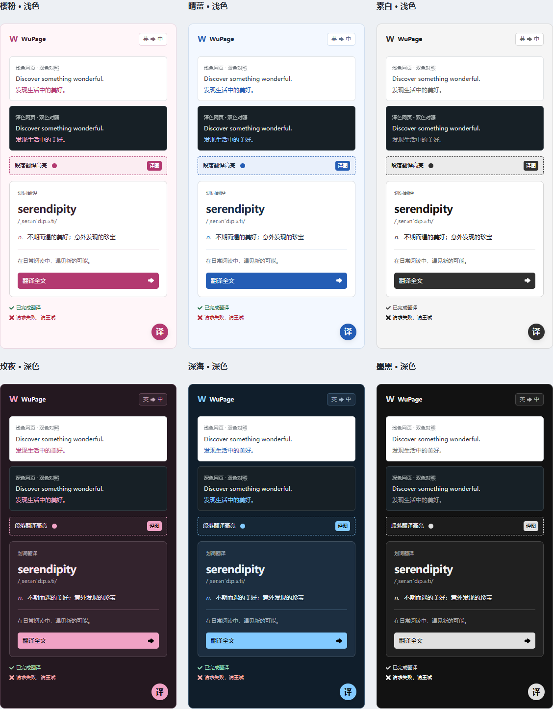

  
  <h1>WuPage Translator</h1>
  
适用于 Microsoft Edge、Chrome 和 Firefox 的网页、视频字幕、图片与 PDF 翻译扩展。

  
支持双语对照、划词查词、暂停画面翻译和 PDF 译文编辑，可选在线服务或本地翻译。

  

    <a href="https://microsoftedge.microsoft.com/addons/detail/wupage-translator/ophhojnppohaklhcdaheplkodopmplfg">Microsoft Edge 插件商店</a> ·
    <a href="https://addons.mozilla.org/zh-CN/firefox/addon/wupage-translator/">Firefox Add-ons</a> ·
    <a href="https://github.com/mr-wuliu/wupage/releases/latest">下载发布包</a> ·
    <a href="https://wupage.mrwuliu.top/">项目主页</a> ·
    <a href="https://github.com/mr-wuliu/wupage/issues">问题反馈</a> ·
    <a href="PRIVACY.md">隐私政策</a>
  

  

    
  

[功能一览](#功能一览) · [效果预览](#效果预览) · [安装](#安装) · [翻译服务](#翻译服务) · [常见问题](#常见问题) · [反馈与交流](#反馈与交流)

## 功能一览

| 功能 | 简要说明 |
| --- | --- |
| 网页全文 | 翻译正文、动态加载和嵌入内容，支持恢复原文 |
| 段落翻译 | 开启后按住 `Ctrl` 点击段落，再次点击恢复原文；不适用于纯触屏设备 |
| 双语显示 | 译文替换、原色对照（默认）、双色对照，可随时切换 |
| 划词翻译 | 选中文字后点击入口查词或翻译；支持有道 / Bing 词典及中文拼音、释义 |
| 自动翻译 | 按网站或页面语言自动翻译，默认关闭 |
| 翻译排除 | 按网站和 CSS 选择器保留指定区域原文，预置可编辑的 X 侧边导航规则 |
| 视频字幕 | 点击播放器上的「译」翻译已有字幕，支持双语显示与 SRT / VTT 导入；不支持无字幕听译 |
| 暂停画面翻译 | 点击播放器上的屏幕图标，识别并翻译画面文字，需开启视频字幕及图片翻译并安装 OCR 模型 |
| 图片翻译 | 通过扳手安装 OCR 模型并开启功能，点击图片旁的「译」原位显示译文；识别在本机完成 |
| PDF 阅读 | 打开后自动翻译当前页附近内容，支持原译对照及译文编辑；需有文本层 |
| PDF 导出 | 下载前补全全文翻译；可导出图像版，或安装可选字体后导出可搜索文字 |
| 悬浮球与右键菜单 | 在网页内翻译、恢复原文或切换设置；右键翻译需先开启 |
| 外观与菜单 | 明暗主题、自定义配色、悬浮球透明度，以及菜单入口的显示和排序 |
| 快捷键 | 默认 `Alt+Shift+Y` 翻译全文；按键和开关可在设置中修改 |
| 使用统计 | 查看用量、成功率、响应时间与接口返回的 Token，默认关闭，仅保存在本机 |

## 效果预览

**译文替换 · 日语 → 简体中文**

| 原文 | 译文 |
| --- | --- |
|  |  |

**PDF 双栏对照 · 英语 → 简体中文**

**外观配色 · 浅色 / 深色**

## 安装

### Microsoft Edge

从 [Microsoft Edge 插件商店](https://microsoftedge.microsoft.com/addons/detail/wupage-translator/ophhojnppohaklhcdaheplkodopmplfg) 点击「获取」安装，并将 WuPage 固定到工具栏。

### Firefox

从 [Firefox Add-ons](https://addons.mozilla.org/zh-CN/firefox/addon/wupage-translator/) 安装，需要 Firefox 154 或更新版本。Releases 中的 Firefox ZIP 未经 Mozilla 签名，仅供临时测试。

### Chrome / Edge 手动安装

1. 从 [Releases](https://github.com/mr-wuliu/wupage/releases/latest) 下载 `wupage-<version>-chrome.zip` 或 `wupage-<version>-edge.zip` 并解压。
2. 打开 `chrome://extensions` 或 `edge://extensions`，开启「开发人员模式」。
3. 点击「加载已解压的扩展程序」，选择包含 `manifest.json` 的解压目录。

手动更新时，用新版文件替换原目录内容，再到扩展管理页重新加载。安装或更新后，刷新已打开的网页。

## 翻译服务

在「设置 → 翻译服务」配置并保存，在弹窗中选择实际使用的服务。

| 服务 | 使用条件 |
| --- | --- |
| Microsoft、Google、腾讯、Yandex、火山 | 预置无需密钥的免费服务，也可切换为自备凭据的 API 模式 |
| MyMemory | 匿名免费服务或 RapidAPI，适合少量文本 |
| 豆包（实验性） | 在同一浏览器中登录豆包，无需 API Key；仅支持 Chrome / Edge |
| DeepSeek / Zhipu GLM | 对应平台的 API Key 和模型 |
| OpenAI / Anthropic 兼容服务 | 自定义服务地址、模型、密钥和提示词；OpenAI 兼容服务可连接 Ollama 等本地接口 |
| HTTP 模板 | 自定义请求地址、参数与响应路径 |
| Firefox 本地翻译（实验） | 使用 Bergamot 引擎，Chrome / Edge 也可使用；需先下载或导入语言模型，准备完成后可离线翻译 |

免费服务可能受限流、地区和接口变更影响。服务失败时需手动重试或切换，不会自动转发到其他服务；支持语言、额度与费用以服务商为准。

本地翻译模型每个语言方向约 35–55 MB，非英语之间的翻译可能需要经英语中转的两个方向。选择服务不会自动下载模型；缺少模型时按设置页提示安装。

## 常见问题

| 问题 | 处理方法 |
| --- | --- |
| 点击翻译无响应 | 安装或更新后刷新网页；浏览器内置页、扩展内部页和商店受限页面无法翻译 |
| 服务报错或限流 | 检查网络、密钥、登录状态及额度，在弹窗的 Debug 面板查看原因后重试 |
| 部分内容未翻译或排版异常 | 检查翻译排除规则，尝试「译文替换」或段落翻译；编辑区和部分网页绘图内容不支持正文翻译 |
| 图片或画面识别失败 | 确认 OCR 模型已安装，图片可访问且视频画面无遮挡；复杂背景、艺术字和受保护视频可能无法处理 |
| 本地 PDF 无法打开 | 在扩展详情中开启文件访问权限，或直接在 PDF 工作区选择、拖入文件；扫描版 PDF 暂不支持 |
| 导出的 PDF 无法搜索文字 | 图像版导出不含可选文字，安装完整字体后重新导出 |
| 找不到功能入口 | 在「设置 → 外观 → 菜单功能」添加入口或恢复默认布局 |

## 隐私说明

在线服务只接收待翻译文字及其所需凭据，图片、视频画面和 PDF 文件不上传给翻译服务。本地翻译在设备上处理文本，划词查词仍使用在线词典。设置、凭据、缓存和可选统计保存在当前浏览器，WuPage 不提供翻译代理或分析服务。详见[隐私政策](PRIVACY.md)。

弹窗中的「清除缓存」仅清理翻译结果；OCR 模型、本地翻译模型、PDF 字体和使用统计需在各自入口单独删除。

## 反馈与交流

通过 [Issues](https://github.com/mr-wuliu/wupage/issues) 提交问题，附上浏览器与扩展版本、翻译服务、复现步骤和脱敏后的 Debug 错误信息。

QQ 开发交流群：**582857596**。

源码构建、项目结构和验证说明见[开发指南](docs/development.md)。

## 致谢

界面通用图标采用 Nieobie 的 [Game Icon Pack](https://github.com/Nieobie/game-icon-pack)（CC0 1.0）。
