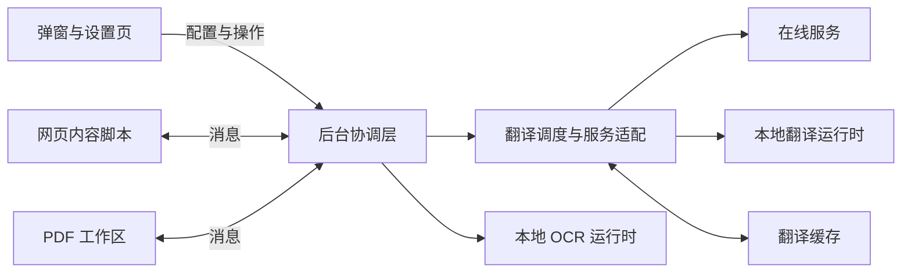

# 开发指南

[返回 README](../README.md)

本文介绍 WuPage 的设计思路、代码组织，以及从本地构建到验证改动的开发流程。

## 设计思路

- **阅读场景与翻译能力分离。** 网页、PDF、图片和字幕各自负责内容提取与显示，文本翻译共用后台的服务适配、调度和缓存，避免为每个场景重复实现请求逻辑。
- **保留原始内容，支持撤销。** 网页译文跟随原有文档结构，恢复原文时还原节点；显示模式切换优先复用译文。网站适配依据稳定的结构或协议，并验证原文恢复与动态更新。
- **异步任务有明确归属。** 页面、嵌入文档和视频会话分别管理任务生命周期。停止、导航或配置变化后取消旧任务，结果返回时再次检查所属会话，避免过期译文覆盖当前内容。
- **按需使用本地资源。** OCR 和本地翻译通过独立运行环境执行，计算与缓存有资源边界。执行代码随扩展打包，模型和可选 PDF 字体由用户安装并校验，普通构建无需下载这些数据。
- **收敛浏览器差异。** Chrome、Edge 和 Firefox 共用业务源码，通过构建配置和运行环境适配处理 Manifest、后台及本地推理的差异。

## 项目架构

扩展由网页内的内容脚本、独立扩展页面和后台协调层组成，通过浏览器消息通信。后台统一处理配置、翻译服务请求与本地运行环境的调用。



| 位置 | 职责 |
| --- | --- |
| `src/background/` | 消息处理、跨文档会话、翻译调度、服务商适配与缓存 |
| `src/content/` | 网页内容采集、译文渲染、页面交互与文档生命周期 |
| `src/popup/`、`src/options/` | 扩展弹窗、设置表单与配置草稿 |
| `src/pdf/` | PDF 解析、布局、阅读、编辑与导出 |
| `src/video/` | 字幕解析、播放器适配与页面桥接；网页内的播放器会话位于 `src/content/` |
| `src/ocr/`、`src/local/`、`src/dictionary/` | OCR、本地翻译和词典的专用运行逻辑 |
| `src/shared/` | 消息类型、默认配置、设置规范化及共享界面工具 |
| `public/`、`vendor/` | 随包分发的静态资源、运行库和来源许可 |
| `build/`、`vite.config.ts` | Manifest 转换、构建入口与运行库准备 |
| `tests/`、`scripts/` | 单元与 DOM 测试、浏览器验证及开发工具 |
| `docs/` | 开发指南、专题分析与示例资料 |

主要入口是 `src/background/index.ts`、`src/content/index.ts`，以及根目录的 `popup.html`、`options.html`、`pdf.html`。消息协议在 `src/shared/types.ts`，默认配置与旧设置兼容分别由 `defaults.ts`、`settings.ts` 管理。

文本翻译先经过后台的缓存与批次调度，再进入服务适配层；返回值通过格式与受保护内容校验后交还调用方。网页 DOM 操作留在内容脚本，服务协议处理留在后台，公共配置和类型放入共享层。

Chrome / Edge 使用后台 Service Worker，并通过 offscreen 文档承载需要 DOM 或 Worker 的本地能力；Firefox 使用后台事件页和隐藏 iframe。相关适配入口为 `build/manifest.ts` 与 `src/background/offscreen.ts`。

## 环境搭建

需要 Node.js 22 或更新版本及 npm。

```bash
git clone https://github.com/mr-wuliu/wupage.git
cd wupage
npm ci
npm run build
```

普通开发使用仓库内已有的 OCR 运行库，不需要本机安装 C++ 编译工具链。模型安装与翻译服务配置通过扩展界面完成。

## 本地开发

1. 根据改动所属的界面、阅读场景或后台能力定位模块；跨模块通信先查看共享消息类型。
2. 启动对应浏览器的监听构建，修改源码后检查构建输出。
3. 在扩展管理页重新加载扩展，并刷新用于验证的网页。
4. 按需补充能复现问题的测试或本地样例，执行与改动范围相符的验证。

| 命令 | 用途 |
| --- | --- |
| `npm run dev` | 监听源码，持续生成 Chrome / Edge 构建到 `dist/` |
| `npm run dev:firefox` | 监听源码，持续生成 Firefox 构建到 `dist-firefox/` |
| `npm run build` | 生成 Chrome / Edge 生产构建 |
| `npm run build:firefox` | 生成 Firefox 生产构建 |

Chrome / Edge 在扩展管理页开启开发人员模式，加载 `dist/`；具体入口见 [README 安装说明](../README.md#安装)。Firefox 154 或更新版本可在 `about:debugging#/runtime/this-firefox` 临时加载 `dist-firefox/manifest.json`，源码更新后点击「重新载入」并刷新网页。

监听构建只更新输出文件，浏览器中的扩展和已有网页仍需重新加载。排查问题时使用独立浏览器资料，避免与已安装的商店版同时作用于同一页面。

修改配置结构时，保留旧设置的默认值与迁移逻辑；新增服务时接入已有服务适配与错误处理；调整公共界面时复用配色变量和 `src/shared/ui-icons.ts`，保持各入口一致。

## 验证改动

先运行受影响模块的测试，例如：

```bash
npm test -- tests/appearance.test.ts
```

业务改动的基础检查为：

```bash
npm run typecheck
npm test
npm run build
```

涉及 DOM、布局、浏览器权限或消息生命周期时，再运行对应浏览器验证。`package.json` 中的 `test:*` 命令列出全部入口，例如 `test:page`、`test:appearance` 和 `test:firefox`；运行前先构建对应的 `dist/` 或 `dist-firefox/`。

Chromium 浏览器测试需要可导入的 Playwright 和可用浏览器，可单独准备：

```bash
npm install --no-save --package-lock=false playwright
npx playwright install chromium
npm run test:page
```

也可通过 `PLAYWRIGHT_MODULE` 指定已有 Playwright 模块。浏览器路径由对应脚本的 `CHROME_TEST_BROWSER`、`EDGE_TEST_BROWSER`、`PDF_TEST_BROWSER` 或 `FIREFOX_BINARY` 指定；Firefox 测试使用本机浏览器及 Marionette。

浏览器验证通常使用独立资料目录、本地样例和模拟翻译服务，报告与截图保存在被 Git 忽略的 `.npm-cache/`。OCR、本地模型与部分 PDF 验证可能下载公开数据，运行前查看对应脚本。样例通过说明流程和排版符合预期，真实站点兼容性与译文质量仍需分别验证。

## 调试

网页内容脚本在目标网页的开发者工具中调试；弹窗、设置页和 PDF 工作区使用各自的开发者工具。后台日志从扩展管理页的 Service Worker 检查入口查看，Firefox 使用 `about:debugging`。翻译链路的请求状态和错误可通过扩展的 Debug 面板查看。

构建默认不生成 source map。本地排查需要时，可在 PowerShell 中开启后重新构建：

```powershell
$env:WUPAGE_SOURCEMAP = '1'
npm run build
```

定位问题时先区分内容采集、任务调度、服务响应和译文渲染，再用最小页面或模拟响应复现。提交日志与样例前移除密钥、登录信息和敏感正文。

## 相关资料

- [PDF 排版验证](pdf-regression.md)：复杂文档样本与专项验证方法。
- [版本记录](releases/)：已发布版本的功能变更与修复说明。
