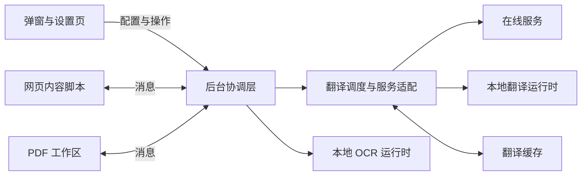

# 开发指南

[返回 README](../README.md)

本文介绍 WuPage 的设计思路、代码组织，以及从本地构建到验证改动的开发流程。

## 设计思路

- **阅读场景与翻译能力分离。** 网页、PDF、图片和字幕各自负责内容提取与显示，文本翻译共用后台的服务适配、调度和缓存，避免为每个场景重复实现请求逻辑。
- **保留原始内容，支持撤销。** 网页译文跟随原有文档结构，恢复原文时还原节点；显示模式切换优先复用译文。网站适配依据稳定的结构或协议，并验证原文恢复与动态更新。
- **异步任务有明确归属。** 页面、嵌入文档和视频会话分别管理任务生命周期。停止、导航或配置变化后取消旧任务，结果返回时再次检查所属会话，避免过期译文覆盖当前内容。
- **按需使用本地资源。** OCR 和本地翻译通过独立运行环境执行，计算与缓存有资源边界。执行代码随扩展打包，模型和可选 PDF 字体由用户安装并校验，普通构建无需下载这些数据。
- **收敛浏览器差异。** Chrome、Edge 和 Firefox 共用业务源码，通过构建配置和运行环境适配处理 Manifest、后台及本地推理的差异。

## 项目架构

扩展由网页内的内容脚本、独立扩展页面和后台协调层组成，通过浏览器消息通信。后台统一处理配置、翻译服务请求与本地运行环境的调用。



| 位置 | 职责 |
| --- | --- |
| `src/background/` | 消息处理、跨文档会话、翻译调度、服务商适配与缓存 |
| `src/content/` | 网页内容采集、译文渲染、页面交互与文档生命周期 |
| `src/popup/`、`src/options/` | 扩展弹窗、设置表单与配置草稿 |
| `src/pdf/` | PDF 解析、布局、阅读、编辑与导出 |
| `src/video/` | 字幕解析、播放器适配与页面桥接；网页内的播放器会话位于 `src/content/` |
| `src/ocr/`、`src/local/`、`src/dictionary/` | OCR、本地翻译和词典的专用运行逻辑 |
| `src/shared/` | 消息类型、默认配置、设置规范化及共享界面工具 |
| `public/_locales/` | 英文和简体中文的界面文案，由浏览器按界面语言选择 |
| `public/`、`vendor/` | 随包分发的静态资源、运行库和来源许可 |
| `build/`、`vite.config.ts` | Manifest 转换、构建入口与运行库准备 |
| `tests/`、`scripts/` | 单元与 DOM 测试、浏览器验证及开发工具 |
| `docs/` | 开发指南、专题分析与示例资料 |

主要入口是 `src/background/index.ts`、`src/content/index.ts`，以及根目录的 `popup.html`、`options.html`、`pdf.html`。消息协议在 `src/shared/types.ts`，默认配置与旧设置兼容分别由 `defaults.ts`、`settings.ts` 管理。

新增界面文案时，在 `en/messages.json` 和 `zh_CN/messages.json` 中使用相同的消息键和占位符。静态页面用 `data-i18n` 标记可见文字，用 `data-i18n-aria-label` 等标记属性。动态控件调用 `src/shared/i18n.ts` 的 `t`，拼接 HTML 时使用会转义参数的 `htmlMessage`。翻译目标、网页原文和用户自定义名称独立于界面语言。

视频字幕布局编辑位于 `src/content/video-layout.ts`，由 `VideoView` 挂载；`src/shared/video.ts` 定义按主机名保存的 `siteLayouts`。水平中心、底边和宽度使用视频区域百分比，字号使用像素；窗口缩放只约束当前显示位置，不改写已保存布局。编辑使用独立的稳定预览，只有点击完成才经原有设置队列写入，不重启翻译。设置备份支持可选布局字段并兼容旧备份。使用 `tests/video-layout.test.ts`、`tests/video-subtitles-ui.test.ts`、`tests/settings-backup.test.ts` 和 `npm run test:video` 验证交互、保存和真实播放器布局。

PDF 的参考文献边界由 `src/pdf/document.ts` 按标题所属栏及上下位置识别，居中的附录标题也会结束该栏的文献保护。`src/pdf/paragraph-flow.ts` 在请求层连接相邻栏及相邻页之间的连续段落，原有物理区域仍用于排版、编辑和导出。跨页连接从前页最后一栏的正文末尾到后页第一栏的正文开头，排除页眉、页脚、图注和新章节边界，并修复断词连字符；模糊边界保留独立请求，另提供有界的相邻页原文上下文。合并时为各区域的公式、引用及格式标记重新分配独立编号；返回后先校验完整结构，再一次性恢复到各区域，避免残缺结果覆盖页面。

跨页段落由起始页拥有一个共享请求，后续页登记依赖。`src/pdf/translation-queue.ts` 根据请求涉及的任一页判断阅读优先级、取消和重试；注册依赖页不扩大普通段落的翻译范围，翻页及导出复用已完成结果。独立标题、表格、参考文献及归属不明的区域不参与合并。修改此逻辑时运行 `tests/pdf-document.test.ts`、`tests/pdf-paragraph-flow.test.ts`、`tests/pdf-translation-queue.test.ts`、`tests/pdf-opening.test.ts` 和 `tests/pdf-download.test.ts`，再用真实多栏文档检查预览与导出。

文本翻译先经过后台的缓存与批次调度，再进入服务适配层；返回值通过格式与受保护内容校验后交还调用方。网页 DOM 操作留在内容脚本，服务协议处理留在后台，公共配置和类型放入共享层。

`src/background/providers.ts` 是服务工厂；`providers/` 按在线翻译服务、LLM 和 HTTP 模板组织适配器，`provider-transport.ts` 统一管理超时、重试与响应读取。网页渐进扫描的分块、让出主线程及变更补扫位于 `src/content/progressive-scan.ts`，内容判断与渲染仍由 `dom.ts` 处理。正文采集测试使用与产品相同的渐进扫描入口。

DeepL 适配位于 `src/background/providers/deepl.ts`，负责语言代码、按条数与 UTF-8 请求体大小分批、结果顺序及错误状态；空接口地址按密钥选择官方 Free / Pro 服务。上下文通过独立参数传递，不拼入计费原文；请求复用现有的临时来源请求头兼容规则，仅作用于扩展自身的目标 POST 地址。Index-Translate 复用 OpenAI 兼容请求链路，提供本地桥接预设、关闭思考的请求参数及前置思考块过滤。两项服务纳入设置规范化、性能参数、请求模板（Index-Translate）和备份恢复。`tests/deepl-provider.test.ts`、`tests/index-translate-provider.test.ts` 通过模拟接口验证协议和异常，`tests/options-provider-state.test.ts` 检查界面保存。构建后运行 `npm run test:translation-providers` 可检查实际扩展请求和窄屏设置页，支持 `-- --edge`、`-- --firefox`；报告位于 `.npm-cache/translation-providers/`。这些测试不使用真实密钥、不访问在线翻译服务或安装模型。

`src/content/text-flow.ts` 根据计算样式和交互归属，将连续文本识别为共享范围。鼠标和触屏通过原生文字命中定位具体节点；悬停、快捷键和整页采集共用同一套边界，首尾裸文本无需 `<p>` 包裹。行内链接与格式保持在同一范围，独立块及布局字段分别处理，连续 `<br>` 分段，单个显式换行使用受保护标记传输。`text-flow-sources.ts` 在需要时为匿名范围建立可撤销的源容器，保留原始节点；`inline-translation.ts` 使用相同的排版判断复用原始格式节点。返回译文前再次校验范围，布局已变化时丢弃旧结果。站点适配只补充正文政策或专有内容读取方式。

`tests/text-flow.test.ts`、`tests/line-break-paragraphs.test.ts` 和 `tests/page-translation.test.ts` 覆盖标签与包装变化、CSS 行内/块级切换、长段落、显式换行、动态更新和精确恢复。构建后运行 `node scripts/test-text-flow.mjs --edge` 或 `--firefox`，用独立浏览器及本地模拟服务检查原生点选、首尾裸段、三种显示模式、链接与按钮、整页及增量翻译；结果保存在 `.npm-cache/text-flow/`。

网页翻译使用绑定到原节点的写入计划。`translation-boundaries.ts` 将自定义组件、插槽和交互元素作为独立范围；`dom-roots.ts` 通过扩展接口发现开放及封闭的 Shadow DOM，并记录实际插槽路径。`TextSegment.text` 保留可读原文，`requestText` 按需生成用于传输的格式标记。`inline-translation.ts` 只接纳已确认的句内格式，替换模式复用原文本和格式节点，双语模式生成展示副本。共享校验器检查标记数量、配对、嵌套和非空内容；失效结果不写入页面，后台对损坏标记执行有界重试和保留结构的分片回退。本地引擎将这些格式标记转换为受限 HTML，利用 Bergamot 对齐后再还原标记；其他服务继续使用受保护的文本协议。

`npm run test:structured:edge` 和 `npm run test:structured:firefox` 使用独立浏览器配置与本地翻译服务，检查开放/封闭组件、原节点身份、格式顺序、点击行为、动态更新及精确恢复。真实本地模型验证使用 `npm run test:structured:local`，需先构建 Firefox，并通过 `LOCAL_MODEL_FIXTURE_DIR` 指向已有的 `en-zh-Hans` 模型目录；测试校验模型文件哈希，不下载模型。模型 HTML 对齐结果不符合结构约束时，测试同时检查受保护文本回退。

普通配置保存通过 `SAVE_SETTINGS` 同时提交编辑结果和读取时的 `previousSettings`。后台按顺序合并本次变更，保留其他页面修改的字段；服务配置按稳定 ID 合并，避免覆盖其他服务的凭据或重新创建已删除服务。完全重置由确认窗口触发 `RESET_SETTINGS`，在共享写入队列中完整替换为默认配置，并返回该次写入结果。界面等待已有保存完成，且只在重置成功后更新表单与保存基线；取消或写入失败保留原配置、密钥及草稿。新增保存入口应遵循同一约定，避免直接写入整个配置对象。

重置确认与交互保护位于 `src/options/reset-settings.ts`。入口和确认按钮复用警告色 `--wp-danger`，通过 `--wp-on-danger` 自动选择可读文字色。确认窗口默认聚焦取消；未提交时支持 Esc，写入期间禁止重复确认与提前关闭。使用 `npm run test:settings-reset`、`npm run test:settings-reset:edge`、`npm run test:settings-reset:firefox` 验证真实取消、确认、密钥清除、不同配色对比度和窄屏布局，均使用独立测试配置。

设置备份格式与字段校验位于 `src/shared/settings-backup.ts`，界面位于 `src/options/settings-backup.ts`。配置仅使用 TOML，由固定版本的 `smol-toml` 解析与序列化，禁止不安全键并限制嵌套深度。TOML 格式 v1 带有固定类型标记、格式版本、扩展版本、导出时间和 `includesKeys` 标记，仅导出声明的配置字段。`pdfTranslationPageRadius` 在文件中用 `"all"` 表示内部的无限范围空值；多行提示词与模板复用库的转义规则输出为 TOML 多行字符串。解析错误仅提示行列，不显示可能含凭据的源码片段。

默认不含密钥；`src/shared/settings-backup-credentials.ts` 清空专用密钥字段和可识别的认证值，保留其余配置，不再删除整段地址、提示词、请求头或模板。对模板文本按认证字段处理，同时保留 `{{apiKey}}` 等引用；URL 不经过重新序列化，避免改变路径大小写、编码和占位符。已识别的长凭据副本也会从请求内容中移除，短密钥不做任意子串替换，避免损坏普通文本。未知自定义字段或任意正文中的手写密钥不能保证识别，界面提示分享前人工检查。确认窗口每次打开均重置为不包含密钥，只有用户主动勾选才生成完整备份。无密钥导入按同一规则检查专用字段和可识别的认证值，不只信任文件标记。

导入通过 `IMPORT_SETTINGS` 在后台重复校验文件，再经共享写入队列完整替换设置；两种模式均不合并本机凭据，无密钥导入会清空旧凭据并明确提示重新配置。后台在写入前检查当前 OCR 后端；内置模型缺失时只关闭图片翻译，自定义服务检查配置且不发起识别请求。校验或写入失败不会更新表单基线，也不会清空其他存储。新增配置字段或服务类型时须同步更新备份字段声明与无密钥投影；不兼容的结构调整须升级格式版本并实现迁移。

OCR 后端入口为 `src/background/ocr.ts`，HTTP 协议校验、请求及取消位于 `src/background/ocr-service.ts`，配置归一化位于 `src/shared/ocr-service.ts`，设置与样例预览位于 `src/options/ocr-service.ts`。[接口协议](ocr-service.md)约定像素坐标与大小限制。HTTP 模式不启动本地 OCR 运行环境，不将图片传给文本翻译服务，不自动重试或回退；存储变更取消过期识别任务，翻译入口在识别后及缓存写入前重复检查配置。模型缓存版本由用户维护，以处理服务端同名权重更新。`TEST_OCR_SERVICE` 与 `CANCEL_OCR_TEST` 仅接受扩展设置页的消息。

`tests/ocr-service*.test.ts` 覆盖协议、异常响应、有界读取、认证、取消、缓存隔离、备份与设置。浏览器集成检查使用 `node scripts/test-ocr-service.mjs`，通过本机模拟 OCR 与翻译服务验证配置、识别预览、图片覆盖和窄屏布局，不下载模型、不联系真实服务。

使用 `npm run test:settings-backup`、`npm run test:settings-backup:edge` 或 `npm run test:settings-backup:firefox` 验证实际下载、导入确认、配置与表单同步、缺失模型、后续普通保存及窄屏布局。测试使用独立浏览器配置和模拟凭据，不调用翻译服务。

Chrome / Edge 使用后台 Service Worker，并通过 offscreen 文档承载需要 DOM 或 Worker 的本地能力；Firefox 使用后台事件页和隐藏 iframe。相关适配入口为 `build/manifest.ts` 与 `src/background/offscreen.ts`。

Mozilla 模型 CDN 会拒绝 Chromium 的 User-Agent。`src/background/local-model-compatibility.ts` 为扩展发起的官方模型 GET 请求设置 WuPage 下载标识，覆盖自动下载与设置页中的文件链接；规则不匹配其他网站请求，Firefox 保留原生标识。Chromium offscreen 文档通过后台取得界面语言，再读取扩展内的语言包，避免缺少 i18n API 时显示消息占位符。

`node scripts/test-local-translation.mjs` 默认下载真实英译中模型，检查自动下载、两类手动文件链接的校验值和断网翻译。设置 `LOCAL_MODEL_FIXTURE_DIR` 可复用已有模型，在本地模拟 HTTP 503、下载中断及续传，并检查离线导入；无需访问模型 CDN。

后台重启后，`src/background/frame-sessions.ts` 从浏览器的当前文档树恢复页面登记。主页面和嵌入页面通过同步的 `FRAME_IDENTIFY` 返回文档标识，已启用的翻译运行时同时返回本地状态；该应答不等待后台请求、不启动翻译。只有文档身份仍有效且会话编号一致时才恢复统计，避免把导航前的状态用于新页面。`npm run test:background-resume` 和 `npm run test:background-resume:edge` 在静态页面保持打开时终止真实后台，检查首次翻译、跨域嵌入页面、停止及已有译文恢复；全部请求使用本地模拟服务。

## 环境搭建

需要 Node.js 22 或更新版本及 npm。

```bash
git clone https://github.com/mr-wuliu/wupage.git
cd wupage
npm ci
npm run build
```

普通开发使用仓库内已有的 OCR 运行库，不需要本机安装 C++ 编译工具链。模型安装与翻译服务配置通过扩展界面完成。

## 本地开发

1. 根据改动所属的界面、阅读场景或后台能力定位模块；跨模块通信先查看共享消息类型。
2. 启动对应浏览器的监听构建，修改源码后检查构建输出。
3. 在扩展管理页重新加载扩展，并刷新用于验证的网页。
4. 按需补充能复现问题的测试或本地样例，执行与改动范围相符的验证。

| 命令 | 用途 |
| --- | --- |
| `npm run dev` | 监听源码，持续生成 Chrome / Edge 构建到 `dist/` |
| `npm run dev:firefox` | 监听源码，持续生成 Firefox 构建到 `dist-firefox/` |
| `npm run build` | 生成 Chrome / Edge 生产构建 |
| `npm run build:firefox` | 生成 Firefox 生产构建 |

Chrome / Edge 在扩展管理页开启开发人员模式，加载 `dist/`；具体入口见 [README 安装说明](../README.md#安装)。Firefox 154 或更新版本可在 `about:debugging#/runtime/this-firefox` 临时加载 `dist-firefox/manifest.json`，源码更新后点击「重新载入」并刷新网页。

监听构建只更新输出文件，浏览器中的扩展和已有网页仍需重新加载。排查问题时使用独立浏览器资料，避免与已安装的商店版同时作用于同一页面。

修改配置结构时，保留旧设置的默认值与迁移逻辑；新增服务时接入已有服务适配与错误处理；调整公共界面时复用配色变量和 `src/shared/ui-icons.ts`，保持各入口一致。

## 验证改动

划词翻译的选区快照和回填位于 `src/content/selection-source.ts`。普通输入框保存原值及字符偏移，可编辑区域保存原范围和编辑器内容；回填前校验快照，并优先通过浏览器编辑操作保留输入通知和撤销记录。编辑区选区直接使用当前翻译服务，正文继续保留单词查词。`npm run test:selection` 使用本地样例和模拟服务验证部分选区、受控输入通知、表单值、原生撤销、只读及密码框、嵌入页面和窄屏布局；可加 `-- --edge` 验证 Edge。`npm run test:selection:firefox` 使用同类本地输入样例验证 Firefox 的回填及撤销。

先运行受影响模块的测试，例如：

```bash
npm test -- tests/appearance.test.ts
```

业务改动的基础检查为：

```bash
npm run typecheck
npm test
npm run build
```

涉及 DOM、布局、浏览器权限或消息生命周期时，再运行对应浏览器验证。`package.json` 中的 `test:*` 命令列出全部入口，例如 `test:page`、`test:appearance` 和 `test:firefox`；运行前先构建对应的 `dist/` 或 `dist-firefox/`。

Chromium 浏览器测试需要可导入的 Playwright 和可用浏览器，可单独准备：

```bash
npm install --no-save --package-lock=false playwright
npx playwright install chromium
npm run test:page
```

也可通过 `PLAYWRIGHT_MODULE` 指定已有 Playwright 模块。浏览器路径由对应脚本的 `CHROME_TEST_BROWSER`、`EDGE_TEST_BROWSER`、`PDF_TEST_BROWSER` 或 `FIREFOX_BINARY` 指定；Firefox 测试使用本机浏览器及 Marionette。

浏览器验证通常使用独立资料目录、本地样例和模拟翻译服务，报告与截图保存在被 Git 忽略的 `.npm-cache/`。OCR、本地模型与部分 PDF 验证可能下载公开数据，运行前查看对应脚本。样例通过说明流程和排版符合预期，真实站点兼容性与译文质量仍需分别验证。

邮件列表排版使用 `npm run test:mail-layout` 检查表格、网格和 Gmail 式弹性布局；Edge、Firefox 分别使用 `test:mail-layout:edge`、`test:mail-layout:firefox`。覆盖宽窄窗口、等待占位、三种显示模式、动态新增行及恢复原文，同场验证标题、预览和时间保持单行，以及短正文译成长句后正常换行且不横向溢出。行内插入位置不代表单行界面语义，调整换行规则时两类场景必须同时通过。涉及分段、渲染或公共译文样式时应运行此项检查。

嵌入文档连接使用 `npm run test:frame-connection` 验证；Edge、Firefox 分别使用 `test:frame-connection:edge`、`test:frame-connection:firefox`。脚本仅修改临时复制的构建，通过移除测试文档的消息接收器触发浏览器原始连接错误，覆盖隐藏辅助文档失联、无离开通知的文档删除、可见正文失联及新文档重新接入。隐藏辅助文档的不可访问状态保留在 Debug 中，可见正文和主页面的真实错误仍须上报。

扩展重载使用 `npm run test:extension-reload` 验证，Edge 对应 `test:extension-reload:edge`。测试保留正在翻译的视频页和等待视频的嵌入页，重载测试扩展后检查旧任务停止、原字幕恢复、不再产生未捕获异常，并确认刷新页面后能重新翻译。

触屏交互使用 `npm run test:mobile` 检查 320、360、390、430 像素宽度下的菜单、悬浮球长按、一次性段落点选、选区取消事件恢复、短视口划词卡片及图片按钮。`npm run test:floating-responsive` 补充平板横竖屏、鼠标与触屏切换、动态页面上的菜单稳定性。两项检查均使用本地样例和模拟翻译服务，不安装 OCR 或语言模型；可通过 `PLAYWRIGHT_MODULE` 和 `PDF_TEST_BROWSER` 指定工具与 Chromium 浏览器路径。

手机真机复查包括系统长按选词、拖动选区手柄、软键盘弹出、浏览器工具栏伸缩，以及图片长按菜单。桌面 Chromium 的触屏模拟不能替代 Android 浏览器对这些系统交互的验证。

## 调试

网页内容脚本在目标网页的开发者工具中调试；弹窗、设置页和 PDF 工作区使用各自的开发者工具。后台日志从扩展管理页的 Service Worker 检查入口查看，Firefox 使用 `about:debugging`。翻译链路的请求状态和错误可通过扩展的 Debug 面板查看。

构建默认不生成 source map。本地排查需要时，可在 PowerShell 中开启后重新构建：

```powershell
$env:WUPAGE_SOURCEMAP = '1'
npm run build
```

定位问题时先区分内容采集、任务调度、服务响应和译文渲染，再用最小页面或模拟响应复现。提交日志与样例前移除密钥、登录信息和敏感正文。

## 相关资料

- [PDF 排版验证](pdf-regression.md)：复杂文档样本与专项验证方法。
- [版本记录](releases/)：已发布版本的功能变更与修复说明。
